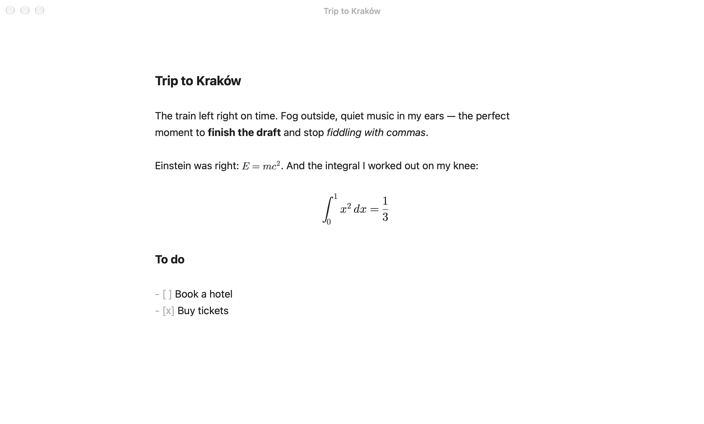

<p align="center"></p>

<h1 align="center">Scribe</h1>

<p align="center"><strong>A calm, minimal Markdown editor for macOS — with LaTeX math.</strong></p>

You write in plain `.md` files in a folder you choose. Formatting appears as you type, and the
Markdown syntax steps aside until your cursor touches it.



## Features

- **Live preview, no preview pane.** Syntax like `**`, `#` and `[](…)` hides until your cursor touches it; the file always stays plain Markdown.
- **Math.** `$…$` inline and `$$…$$` blocks, rendered natively (via [SwiftMath](https://github.com/mgriebling/SwiftMath)), with a live preview while you edit a formula.
- **Typography first.** The Mac's own fonts (SF Pro, New York or SF Mono); a centered column of 64, 72 or 80 characters; light, dark or automatic theme.
- **Focus and typewriter modes.** Fade everything but the current paragraph (⌘D), keep the current line centered (⌘T).
- **Your folder is your library.** Autosave, notes named after their first line, and changes made by other apps picked up instantly.
- **Find anything.** Quick Open by name (⌘⇧O) and full-text search that ignores case and accents (⌘⇧F).
- **Print and PDF.** ⌘P prints a note as a clean document: no Markdown symbols, math and images typeset, tidy pages.
- **Images.** Paste or drag them in; they're copied to an `assets` folder next to the note and shown inline.
- **Keyboard-first.** ⌘B, ⌘I, ⌘K, ⌘1–6, ⌘⇧M and more; Copy as HTML (⌥⌘C).
- **Private by design.** Fully offline and sandboxed; see [Privacy and security](#privacy-and-security).

New to Scribe? Read [**Getting started**](docs/GETTING-STARTED.md) (10 minutes, with pictures).
Every detail is in the [**user manual**](docs/MANUAL.md). Both are also built into the app: **Help → Getting Started** (⌘?).

## Install

> **Status:** version 0.1, in development. The first public release will be published on the
> [Releases](../../releases) page.

**Requirements:** macOS 14 Sonoma or later on a Mac with Apple silicon (M1 or newer).

1. Download `Scribe-<version>-arm64.dmg` from [Releases](../../releases).
2. Open it and drag **Scribe** into **Applications**.
3. On first launch, choose the folder for your notes.

Scribe isn't notarized by Apple yet, so macOS blocks it the first time: open
**System Settings → Privacy & Security** and click **Open Anyway** (once).

**Verify your download** (optional): each release lists SHA-256 checksums and carries a signed
build provenance attestation; see [SECURITY.md](SECURITY.md#build-and-release-integrity).

## Privacy and security

- **Offline.** No accounts, analytics, crash reporting or update checks; web images in notes are never downloaded.
- **Sandboxed.** Scribe runs in the macOS App Sandbox and can only open the notes folder you choose and the files you paste or drag in.
- **Plain files.** Your notes are `.md` files in your folder; nothing is stored anywhere else except the app's own settings.

Found a vulnerability? Please report it privately; see [SECURITY.md](SECURITY.md).

## Build from source

**You need:** Xcode 26 or later (the app uses the macOS 26 SDK), Rust stable with the
`aarch64-apple-darwin` target, and [XcodeGen](https://github.com/yonaskolb/XcodeGen) 2.46.
For `make audit`, also [cargo-deny](https://github.com/EmbarkStudios/cargo-deny).

```sh
git clone https://github.com/ddavidgoraa/scribe.git
cd scribe
make run      # build the Rust core and the app, then launch it
make test     # Rust and Swift tests
make audit    # dependency vulnerabilities, licenses and sources
./scripts/make-dmg.sh   # Release build → dist/Scribe-<version>-arm64.dmg
```

`app/Scribe.xcodeproj` is generated from `app/project.yml` (`make project`); don't edit it by hand.

### How it's built

| Path | What's there |
|---|---|
| `core/mdcore` | Rust core: Markdown parsing with source ranges, library index, full-text and fuzzy search, file watching, word count |
| `core/mdcore-ffi` | The core's Swift bindings, generated with [UniFFI](https://github.com/mozilla/uniffi-rs) |
| `app/Scribe` | SwiftUI and AppKit app: the TextKit 2 editor with live preview, library panel, Quick Open, settings, help |
| `docs/` | User guides (also bundled into the app's Help window) |
| `site/`, `core/scribe-site` | The website (GitHub Pages), built from the guides with the same Markdown code as the app: `make site` |
| `scripts/` | Build, packaging and repository setup scripts; `scripts/icon/` draws the app icon |

## Contributing

Contributions are welcome. `main` always builds and passes its tests; every change goes through a
short-lived branch and a pull request.

1. Fork the repository and create a branch from `main` (for example `fix/quick-open-crash` or
   `feature/word-goal`).
2. Make your change, with tests where it makes sense.
3. Run `make test` and `make audit`, then open a pull request against `main`. CI runs the tests,
   the dependency audit and a security check of the workflows; all must pass before merging.

Please report security issues privately (see [SECURITY.md](SECURITY.md)), not as public issues.

## Roadmap

Next (v0.2): export to HTML with typeset math, sentence focus mode, and a Polish interface.
(PDF is already there: print a note and choose **Save as PDF**.)
Later: notarized releases, full LaTeX documents to PDF, wiki links, a table editor.

## License

Scribe is released under the [MIT License](LICENSE). It uses the system fonts of macOS and bundles
no typefaces. Other components are listed in [THIRD_PARTY_NOTICES.md](THIRD_PARTY_NOTICES.md).
