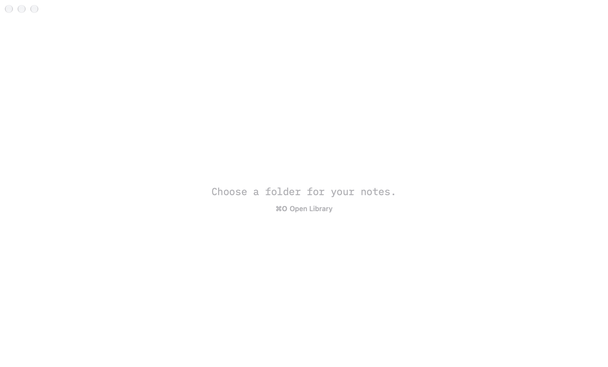
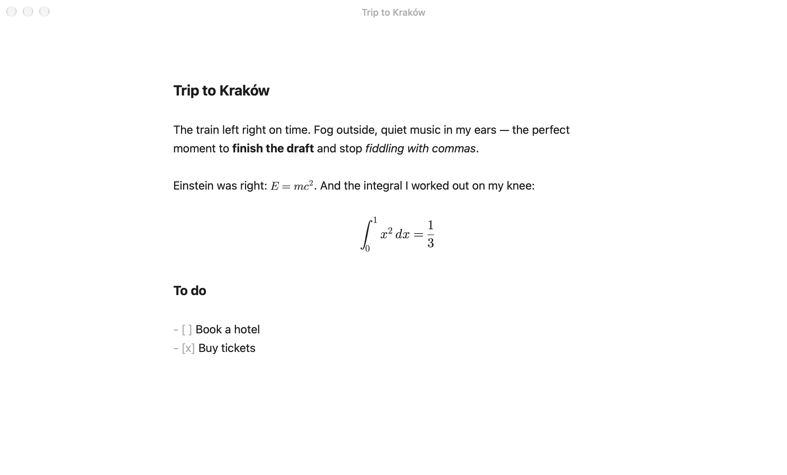
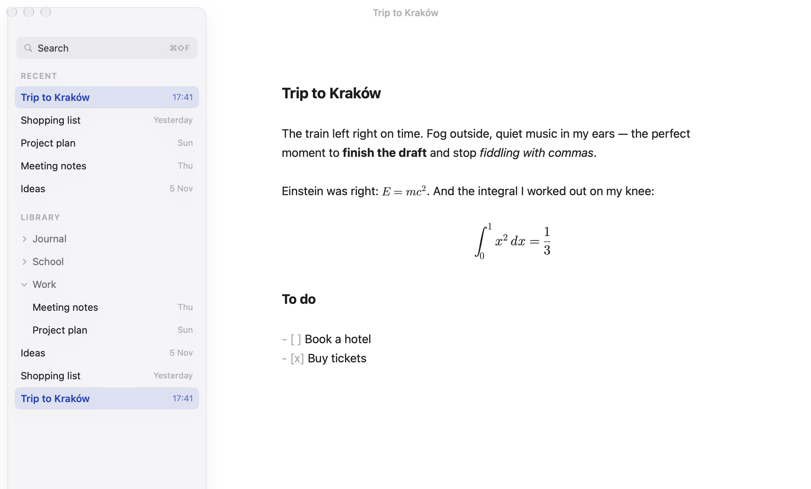
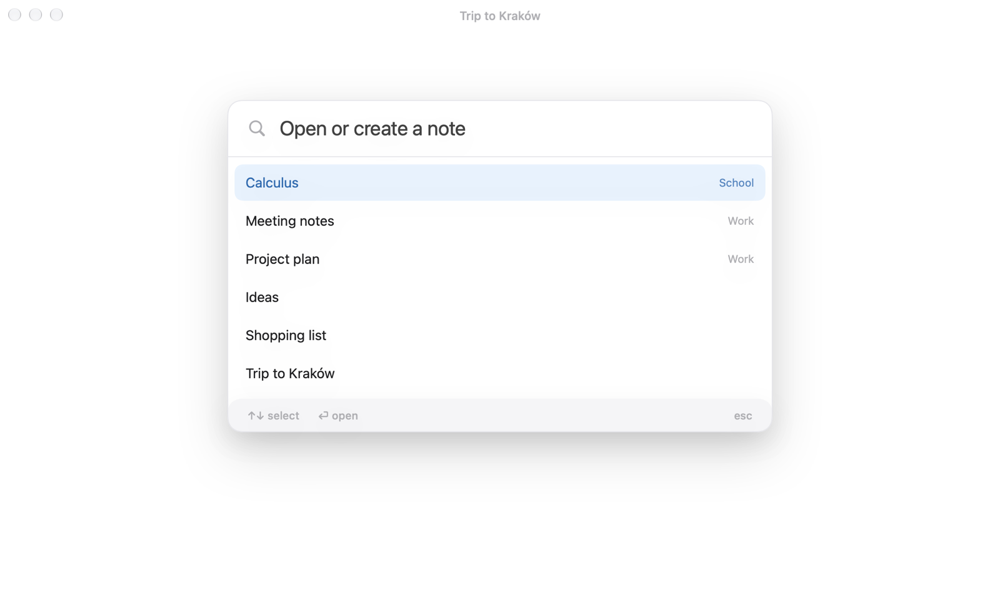
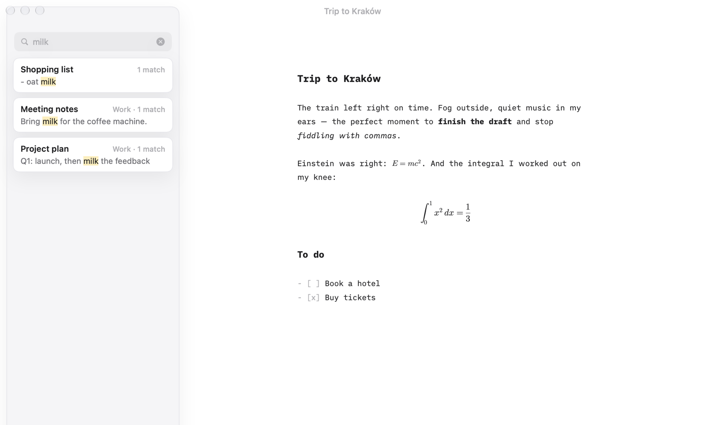
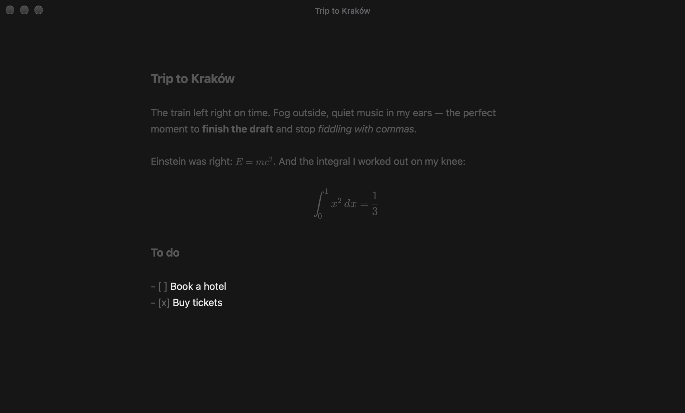

# Getting started with Scribe

Scribe is a calm place to write on your Mac. You type, and your words look nice right away.
Every note is saved for you as a simple file in a folder you choose.

This guide shows you everything you need, step by step. It takes about 10 minutes.
(Looking for every detail? See the [full manual](MANUAL.md).)

> You can open this guide inside Scribe at any time: choose **Help → Getting Started** in the menu bar, or press **⌘?**.

---

## Before you start: the keys

Scribe uses a few keyboard shortcuts. These symbols mean:

| Symbol | Key on your keyboard |
|---|---|
| **⌘** | **Command** (next to the space bar) |
| **⇧** | **Shift** |
| **⌥** | **Option** (sometimes labelled **Alt**) |

So **⌘N** means: hold **Command** and press **N**.
**⌘⇧L** means: hold **Command** and **Shift** together and press **L**.

---

## 1. Install Scribe

1. Open the file **Scribe-0.1.0-arm64.dmg** (double-click it).
2. In the window that opens, drag the **Scribe** icon onto the **Applications** folder.
3. Open Scribe from **Launchpad** or the **Applications** folder.

**The first time, your Mac will say it can't open Scribe.** That's normal for apps that aren't from the App Store yet. To allow it:

1. Open **System Settings** (the grey gear icon).
2. Click **Privacy & Security** on the left.
3. Scroll down and click **Open Anyway** next to Scribe.
4. Confirm with your password or Touch ID.

You only need to do this once.

> Scribe works on Macs with an Apple chip (M1 or newer) and macOS 14 Sonoma or newer.

---

## 2. Choose a folder for your notes

The first time you open Scribe, you see this:



1. Click **Choose a folder for your notes.** (or press **⌘O**).
2. Pick a folder, for example **Documents**. You can also make a new one with **New Folder**, for example "Notes".
3. Click **Open Library**.

That's it. Scribe calls this folder your **library**. All your notes will live there.
For your safety, Scribe can only open this folder — not the rest of your Mac.
Next time you open Scribe, it goes straight back to the note you were writing.

---

## 3. Write your first note

1. Press **⌘N**. A new, empty note opens.
2. Type a title on the first line, for example `# My first note`, and press **Return**.
3. Start writing.



**You never have to save.** Scribe saves your note automatically, about one second after you stop typing.

**You don't have to name the note.** Scribe uses the first line as the name.
If you change the first line later, the name changes too (unless you've renamed the note yourself).

---

## 4. Make your text look nice

You can format text in two ways: with a shortcut or by typing a few symbols.
The symbols disappear when you move on, so you only see the result.
If you click back into the formatted word, the symbols come back so you can change them.

| You want… | Type this | Or select the text and press |
|---|---|---|
| **Bold** text | `**bold**` | **⌘B** |
| *Italic* text | `*italic*` | **⌘I** |
| A big heading | `# Heading` at the start of a line | **⌘1** |
| A smaller heading | `## Heading` | **⌘2** |
| A bullet list | `- ` at the start of a line | |
| A numbered list | `1. ` at the start of a line | |
| A checklist | `- [ ] ` (done: `- [x] `) | |
| A link | `[text](https://example.com)` | **⌘K** |
| ~~Crossed out~~ | `~~text~~` | **⌘⇧X** |

Pressing the same shortcut again removes the formatting.
**Made a mistake?** Press **⌘Z** to undo.

---

## 5. Add a picture

The easiest way: **drag a picture** from Finder (or your desktop) into your note.

You can also:

- **take a screenshot straight into Scribe**: press **⌘⇧⌃4** (Command, Shift, Control and 4), select an area, then click in your note and press **⌘V**;
- **copy a picture** from Preview or Photos and press **⌘V** in your note.

Scribe keeps a copy of the picture in a folder called `assets` next to your note, so the picture stays with your notes even if you delete the original.
(If the picture is already inside your notes folder, Scribe simply points to it instead of copying it.)

---

## 6. Write math (optional)

If you need formulas, Scribe can draw them for you. It uses LaTeX, the standard way to type math.

- **In a sentence:** put the formula between two dollar signs: `$E = mc^2$`.
- **On its own line:** put it between double dollar signs, on separate lines:

  ```
  $$
  \frac{1}{2} + \frac{1}{3} = \frac{5}{6}
  $$
  ```

You see the finished formula as soon as your cursor leaves it.
If a formula has a mistake, it turns **red**. Hold your pointer over it to see what's wrong.

---

## 7. Find your notes

### Show all your notes: ⌘⇧L

Press **⌘⇧L** to open the **library panel** on the left. Press it again to hide it.



- **Recent** shows the notes you worked on last.
- **Library** shows all your notes and folders. Click a folder to open it, then click a note.
- The **+** at the bottom makes a new note.
- **Right-click** a note to rename it or show it in Finder.

### Jump to a note by name: ⌘P

Press **⌘P**, type a few letters of the note's name and press **Return**.



You don't need the whole name: `shop` finds "Shopping list".
Nothing found? Press **⌘Return** to create a new note with that name.
Press **Esc** to close the window.

### Search inside all notes: ⌘⇧F

Press **⌘⇧F** and type a word. Scribe shows every note that contains it, with the word highlighted.
Click a line to jump straight to it.



You don't need capital letters or accents: `cafe` also finds "Café".

---

## 8. Write without distractions

Both options are in the **View** menu.

- **Focus mode (⌘D):** everything except the paragraph you're writing fades away.
- **Typewriter mode (⌘T):** the line you're writing stays in the middle of the screen.



Scribe follows your Mac's light or dark appearance automatically. Prefer one of them all the time? Choose it in Settings (see the next step).

---

## 9. Change how it looks

Open **Scribe → Settings…** (or press **⌘,**). A small preview at the top shows how your writing will look as you change things. You can choose:

- **Font:** iA Writer Duo (the default), Mono or Quattro.
- **Size:** how big the text is. Quick shortcuts: **⌘+** bigger, **⌘−** smaller, **⌘0** back to normal.
- **Line length:** how wide the text column is (64, 72 or 80 characters).
- **Theme:** **Light**, **Dark**, or **Auto** to follow your Mac's setting (the default).

---

## Questions people often ask

**Where are my notes?**
In the folder you chose in step 2. Each note is a normal file ending in `.md`. You can open them in any text editor, back them up or sync them with iCloud Drive or Dropbox.
To see the file of a note, right-click it in the library panel and choose **Show in Finder**.

**How do I know my note is saved?**
Move your mouse: a small label in the bottom-right corner shows **Saved**, plus the number of words.

**How do I delete a note?**
Right-click the note in the library panel, choose **Show in Finder**, then drag the file to the **Trash**. Scribe notices and removes it from the list.

**How do I rename a note?**
Right-click it in the library panel and choose **Rename…**.
If Scribe named the note after its first line, you can also just change the first line.

**Why do I see strange symbols like `**` or `#`?**
That's how formatting is written. The symbols appear only around the place where your cursor is, so you can edit them. Click somewhere else and they disappear again.

**A dark message says "This note changed on disk". What happened?**
The same note was changed somewhere else (for example on another computer, or in another app) while you were typing.

- Click **Keep Mine** to keep what you see in Scribe.
- Click **Reload** to take the other version.

**Can I open a different folder?**
Yes: press **⌘O** and choose another folder.

**How do I make a backup?**
Copy your notes folder to another place, such as an external drive or iCloud Drive. That's all there is to it.

---

## The shortcuts on one page

| Press | To |
|---|---|
| **⌘N** | make a new note |
| **⌘P** | open a note by name |
| **⌘⇧F** | search all notes |
| **⌘⇧L** | show or hide your notes |
| **⌘B / ⌘I** | bold / italic |
| **⌘1, ⌘2, ⌘3** | headings |
| **⌘K** | link |
| **⌘V** | paste text or a picture |
| **⌘Z** | undo |
| **⌘D** | focus mode |
| **⌘T** | typewriter mode |
| **⌘+ / ⌘−** | bigger / smaller text |
| **⌘,** | settings |
| **⌘O** | open another notes folder |
| **⌘?** | open this guide |
